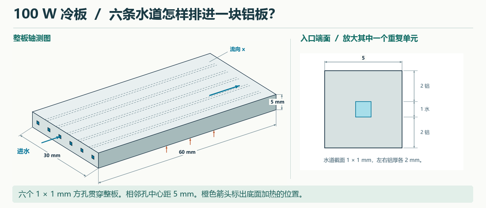
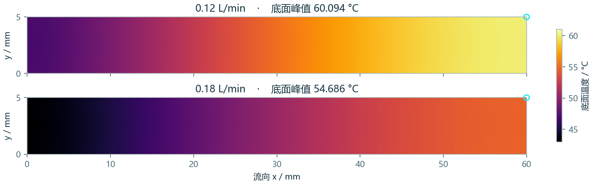
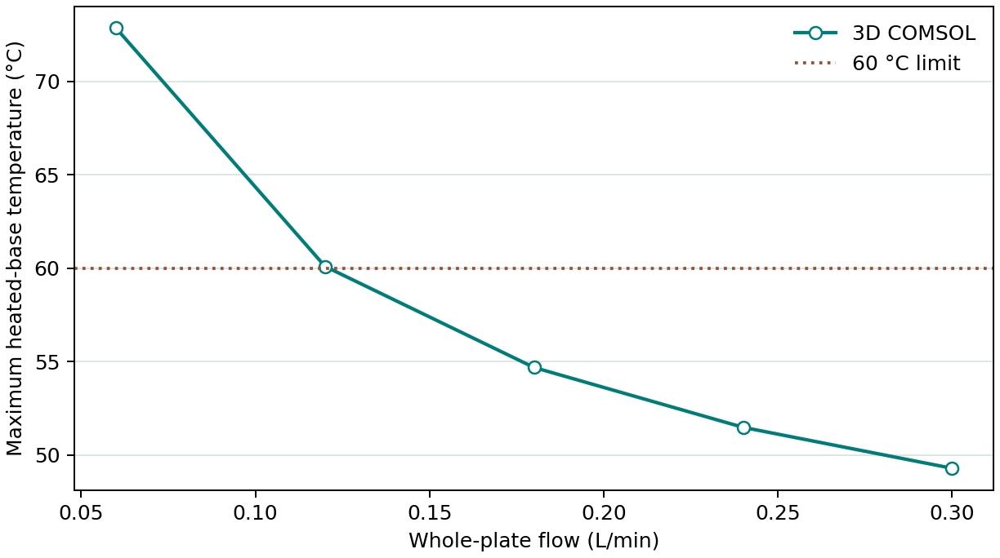
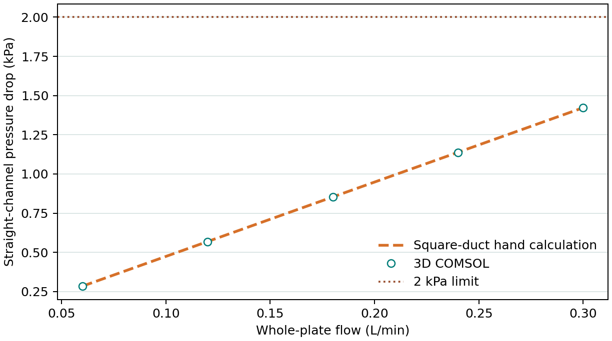

# Flow selection for a 100 W water-cooled cold plate

**0.18 L/min was the lowest of five simulated flow rates that met both design limits.** At 100 W and a 25 °C water inlet, the predicted peak heated-base temperature was **54.686 °C** against a 60 °C limit. The predicted pressure drop over the 60 mm straight channels was **0.854 kPa** against a 2 kPa limit.

## Geometry and heat load

Six 1 × 1 mm channels pass through a 60 × 30 × 5 mm aluminium plate. The blue arrow follows the water from inlet to outlet. The orange arrows locate the uniformly heated underside. The cross-section on the right shows one channel and the surrounding aluminium.

With equal flow through all six channels, one 5 mm-wide repeating section carries one sixth of the heat and water. At the selected setting that is 16.67 W and 0.03 L/min per channel. A steady laminar-flow solution in COMSOL Multiphysics 6.4 supplied the velocity field for heat transfer through the aluminium and water.

## Why the next lower flow misses the limit

The two maps show the same 60 × 5 mm underside. Water enters at the left. The circles mark an outlet-side peak. At 0.12 L/min the medium mesh predicted **60.094 °C**, close enough to the 60 °C limit to warrant a finer mesh. Refinement gave **60.088 °C** at 0.12 L/min and **54.680 °C** at 0.18 L/min.

| Whole-plate flow (L/min) | Peak heated base (°C) | Mixed outlet water (°C) | Straight-channel Δp (kPa) | Both limits |
| ---: | ---: | ---: | ---: | :--- |
| 0.06 | 72.847 | 48.924 | 0.285 | Base too hot |
| 0.12 | 60.094 | 36.962 | 0.569 | Base too hot |
| **0.18** | **54.686** | **32.974** | **0.854** | **Lowest pass** |
| 0.24 | 51.483 | 30.980 | 1.138 | Pass |
| 0.30 | 49.292 | 29.784 | 1.423 | Pass |

All five rows are medium-mesh 3D predictions. The outlet temperature is weighted by mass flow. Increasing flow from 0.18 to 0.24 L/min bought a further **3.20 K** reduction in peak temperature and added **0.285 kPa** of straight-channel pressure drop.

## Checks on the prediction

Open circles are the 3D pressure results. The dashed line is the hand calculation for fully developed flow in a square duct. All six parallel passages span the same pressure difference. An independent 100 W water-side energy balance at 0.18 L/min gives a mixed outlet temperature of 32.974 °C, matching the 3D result to three decimal places.

At the highest flow, the coarse, medium and fine meshes contained 10,176, 25,440 and 55,168 volume elements. Moving from medium to fine changed peak base temperature by 0.0050 K and straight-channel pressure drop by 0.0056%. Across the five flow points, the largest energy imbalance was 0.0284%.

## Bench validation

Cold-plate measurements are pending. The first comparison would use thermocouples near the outlet-side base hot spot at 0.12 and 0.18 L/min, with the inlet held at 25 °C. The lower-flow prediction lies only 0.088 K above the limit, so the temperature uncertainty matters to that comparison. Measuring flow and mixed inlet and outlet temperatures would close the water-side heat balance. Pressure taps at the channel ends would test the reported pressure drop. Taps across the fittings would also include manifold and fitting losses.
